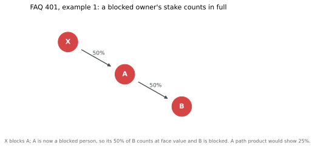
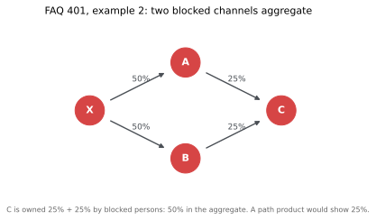
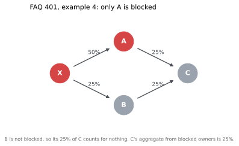
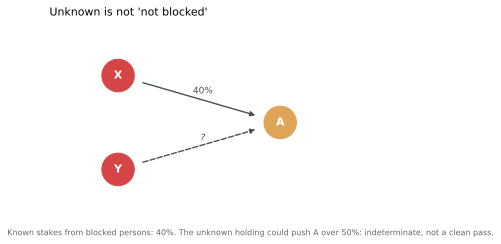
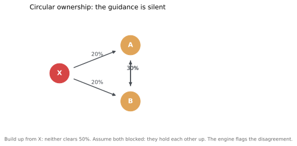

# ownership-50

A reference implementation of OFAC's 50 Percent Rule ownership arithmetic, tested against OFAC's own published examples.

**This is a testing and teaching aid. It does not make compliance determinations, and it is not legal advice.** It exists so that sanctions-screening code, list-diff tooling and analyst training material have something small, deterministic and open to check themselves against.

## The one-sentence version of the rule

An entity is blocked if it is owned 50 percent or more **in the aggregate** by one or more **blocked persons** - and once an entity is blocked, it is itself a blocked person, so every stake it holds counts **in full** toward the entities it owns.

That last clause is where naive implementations go wrong. The usual beneficial-ownership calculation multiplies percentages along each path. OFAC's rule does not:



A path product gives B 25% and a clean pass. OFAC's published answer is that **B is blocked**: A is blocked, so A's 50% of B counts at face value. Examples 1-3 of [FAQ 401](https://ofac.treasury.gov/faqs/401) all disagree with path-product math; example 4 is a case where the two agree, which is why you need all four (plus example 5) as test vectors:




Aggregation is across **all** blocked persons, including persons blocked under different OFAC programs ([FAQ 399](https://ofac.treasury.gov/faqs/399)).

## Install and run

Zero dependencies. Python 3.9+.

```bash
PYTHONPATH=src python3 -m ofac50 examples/faq401_ex1.json
```

```
A: BLOCKED (aggregate 50%)
    - owned 50% in the aggregate by blocked persons (>= 50%)
    chain: X holds 50% [FAQ 401 example 1]
B: BLOCKED (aggregate 50%)
    - owned 50% in the aggregate by blocked persons (>= 50%)
    chain: A holds 50% [FAQ 401 example 1]
X: BLOCKED
    - designated blocked person (program: example, status: blocked)
```

Add `--compare-naive` to see where path-product math would have disagreed, and `--format json` for machine-readable output. Inputs are plain JSON:

```json
{
  "blocked_persons": [{"name": "X", "program": "SDGT", "status": "blocked"}],
  "stakes": [{"owner": "X", "entity": "A", "pct": 50, "source": "analyst record"}]
}
```

Every answer comes with the chain of stakes behind it and the provenance you attached. As a library:

```python
from ofac50 import Seed, Stake, evaluate

results = evaluate(
    seeds=[Seed(name="X", program="SDGT", status="blocked")],
    stakes=[Stake(owner="X", entity="A", pct=50, source="analyst record")],
)
print(results["A"].status)  # "blocked"
```

## What the engine refuses to decide

A tool that always answers "blocked" or "not blocked" is lying about its inputs. Three cases come back **indeterminate**, loudly:

**Unknown stakes.** If a holding's size is unknown, the answer is a range, not a guess. X holds a known 40% of A; blocked person Y holds an undisclosed stake. Known: 40%. Possible: up to 100%. Indeterminate.



**Cycles.** OFAC's guidance is silent on circular ownership. X owns 20% of A and 20% of B; A and B own 30% of each other. Build up from the blocked person and neither clears 50%. Assume both are blocked and they hold each other up. The engine computes both fixed points and flags the disagreement instead of picking one:



**Bad input.** Stakes in one entity summing over 100%, duplicate edges between the same owner and entity, self-ownership, out-of-range percentages: rejected as input errors with exit code 2. A duplicate 30% stake is either a copy-paste or a second holding, and without provenance the engine cannot tell which - summing would say 60% (blocked), dedup would say 30% (not blocked). It refuses to choose for you.

## Test vectors

Every file in `examples/` is a test. The suite (`python3 -m unittest discover -s tests`) replays all of them:

| Vector | Source | Expected |
| --- | --- | --- |
| `faq401_ex1` - `faq401_ex5` | [FAQ 401](https://ofac.treasury.gov/faqs/401), all five published examples | OFAC's stated outcomes |
| `faq399_aggregation` | [FAQ 399](https://ofac.treasury.gov/faqs/399) | cross-program stakes aggregate |
| `unknown_stakes` | worked example | indeterminate, 40-100% |
| `cycle_crossholdings` | worked example | indeterminate, cycle-sensitive |

The suite also checks that naive path-product math disagrees with the engine exactly where OFAC says it should (examples 1-3) and agrees where it should (example 4).

## Scope and limits

- **OFAC's 50 Percent Rule only.** Other regimes define ownership and control differently; none are modeled.
- **Blocked persons only.** Sanctions lists contain more than blocked persons. Some programs use a broader ownership-or-control category; Directive-listed entities carry prohibitions set by each Directive, which can be narrower than full blocking. Seeds carry a `program` and `status`, non-blocked designations are reported but not applied, and the output says what it relied on.
- **Control without 50% ownership is outside the rule** ([FAQ 398](https://ofac.treasury.gov/faqs/398)) - though dealings with a blocked individual acting for a non-blocked entity can still be prohibited ([FAQ 400](https://ofac.treasury.gov/faqs/400)). Flag for human review; the engine cannot.
- **Divestment after designation** has its own conditions, including a sham-transaction check ([FAQ 402](https://ofac.treasury.gov/faqs/402)). Dates and history are out of scope.
- **Output quality is input quality.** Real use needs analyst-supplied stakes; open sanctions datasets generally do not carry reliable ownership percentages. Upkeep is real: someone has to re-read OFAC guidance when it changes.

## Sources

- [OFAC FAQ 401](https://ofac.treasury.gov/faqs/401) - indirect ownership, five worked examples
- [OFAC FAQ 399](https://ofac.treasury.gov/faqs/399) - aggregation across blocked persons and programs
- [OFAC FAQs 398, 400, 402, 373](https://ofac.treasury.gov/faqs/topic/1521) - control, dealings, divestment, Directives
- [OFAC revised 50 Percent Rule guidance, 13 August 2014](https://ofac.treasury.gov/media/6186/download)

Diagrams are generated by `docs/make_figures.py`. MIT licensed. Not legal advice.
